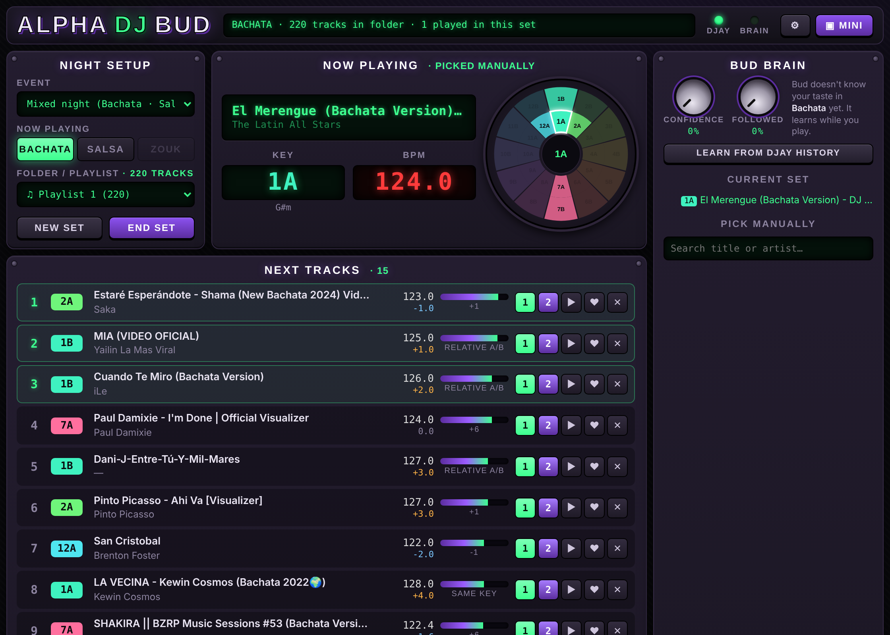
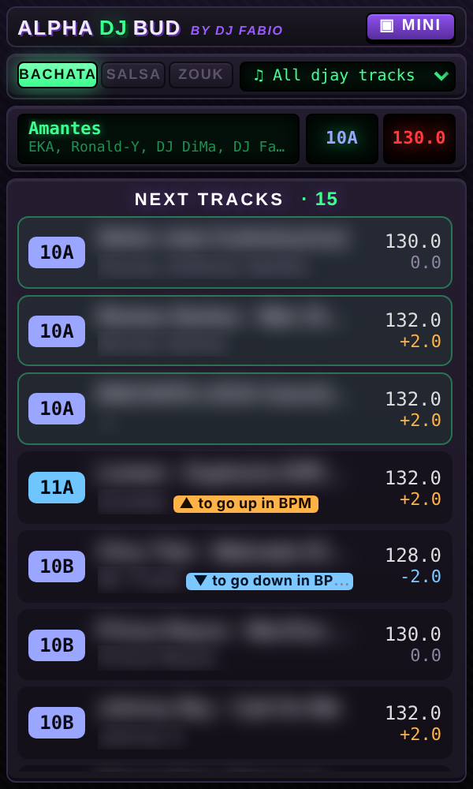

# Alpha DJ Bud

🇬🇧 [English](README.md) · 🇮🇹 **Italiano**

Assistente per DJ che suona con **djay Pro su Mac** e consiglia in tempo reale i prossimi brani per serate di **Bachata, Salsa e Zouk**.



## Cosa fa

1. **Si collega a djay Pro da solo.** Legge (solo in lettura, senza modificare nulla) la libreria di djay: `~/Music/djay/djay Media Library.djayMediaLibrary/MediaLibrary.db`. Quando djay registra un brano come suonato nella sua cronologia, Bud se ne accorge in circa 1–2 secondi. Se serve, puoi impostare a mano il brano in riproduzione con la ricerca a destra.
2. **Si imposta prima della serata:**
   - **Serata**: Bachata, Salsa, Zouk oppure mista (Bachata + Salsa).
   - **Ora suono**: il genere che stai suonando in quel momento.
   - **Cartella/Playlist**: una cartella o playlist di djay per ogni genere (le cartelle includono tutte le playlist che contengono). Bud ricorda la scelta per ogni genere.
3. **Consiglia i prossimi brani** della cartella scelta, con queste regole:
   - **Key (Camelot Wheel)**. Esempio con 3A in riproduzione: **3A, 3B, 2A, 4A** e **9A, 9B** (salto di 6). Vale allo stesso modo per le key B.
   - **BPM**: lo stesso BPM oppure al massimo **±4** (il valore si può cambiare).
   - **Mai lo stesso artista di seguito.** Riconosce anche featuring e collaborazioni ("Romeo Santos & Drake", "feat. Romeo Santos"...). Puoi estendere la regola agli ultimi N brani.
   - Esclude i brani già suonati nel set.
   - **Varietà da una serata all'altra**: se suoni la stessa hit venerdì e sabato, i consigli dopo quel brano cambiano. I brani che ci hai messo dopo di recente, e quelli già proposti allora, scendono in classifica. Durante lo stesso set la lista resta stabile. Si regola in ⚙ Impostazioni → Varietà dei consigli (Spenta / Bassa / Media / Alta).
   - Nella lista ogni artista compare una sola volta in alto. Gli altri suoi brani seguono più in basso.
4. **Impara i tuoi gusti** (sul tuo Mac, offline, separatamente per ogni genere). Registra:
   - i passaggi che fai davvero, seguendo i consigli o no;
   - i brani che suoni più spesso;
   - le relazioni di key che preferisci e se tendi ad alzare o abbassare i BPM;
   - i consigli che ignori sempre;
   - i ♥ e le ✕ che dai.

   Più set suoni, più conta questa parte (indicatore **FIDUCIA**). Con **"Impara dalla cronologia djay"** Bud impara anche dai set che hai già suonato in passato.
5. **Lingua**: l'app è in inglese; in ⚙ Impostazioni → **Lingua** puoi passare a italiano o spagnolo.
6. **Trascinamento in djay**: trascina un consiglio su un deck di djay e rilascialo sulla **forma d'onda** del deck (non sul titolo), come faresti con un file dal Finder. Le righe con il segno ⠿ hanno un file locale. I brani in streaming (TIDAL, Apple Music...) non si possono trascinare: caricali da djay.
7. **Finestra MINI**: con il pulsante **▣ MINI** l'app diventa una finestrella di 360×560 **sempre in primo piano** sopra djay. Mostra solo il genere, il brano in riproduzione e la lista dei consigli.



## Installazione (Mac)

1. Scarica il repository (pulsante verde **Code → Download ZIP**, oppure lo ZIP dell'ultima release) e scompattalo.
2. Fai **doppio clic** su `Install Alpha DJ Bud.command`.
   - Se macOS dice che non è sicuro o non può essere verificato, leggi [Sbloccare l'installer](#sbloccare-linstaller-avviso-di-sicurezza-di-macos) qui sotto.
   - L'installer ha bisogno di internet una volta, per scaricare i componenti.
   - Se manca Python 3, apri il Terminale, lancia `xcode-select --install` e poi rilancia l'installer.
3. L'installer crea **Alpha DJ Bud.app** nella cartella **Applicazioni** del tuo utente (`~/Applications`), con nome e icona propri, e la apre. Trascinala nel Dock per averla sempre a portata di mano. Dopo puoi cancellare la cartella scaricata.
4. Apri djay Pro, scegli il genere e la cartella in Alpha DJ Bud e inizia a suonare.

### Aggiornamenti

Dalla v1.5.0 l'app **si aggiorna da sola**: all'avvio e ogni 6 ore controlla su GitHub se c'è una **release** più nuova. Se c'è, in alto compare il pulsante verde **⬆ vX.Y.Z**. Cliccalo, conferma, e in circa 10 secondi l'app si chiude e si riapre con la nuova versione. Non si aggiorna mai da sola durante un set: scegli tu quando.

- Prima di cambiare, la nuova versione viene provata; se non parte, resta quella attuale. La versione precedente resta come copia di sicurezza in `~/Library/Application Support/Alpha DJ Bud/app.old`.
- ⚙ Impostazioni → Aggiornamenti: attiva/disattiva il controllo automatico o premi **Controlla ora**.
- Impostazioni e memoria di Bud restano sempre.
- Contano solo le **release** pubblicate su GitHub (con un tag tipo `v1.6.0`), non ogni modifica al codice.

Se hai una versione precedente alla 1.5.0, scarica questa versione una volta e lancia `Install Alpha DJ Bud.command`.

### Sbloccare l'installer (avviso di sicurezza di macOS)

macOS (Gatekeeper) blocca tutti i file scaricati da internet che non sono firmati da uno sviluppatore registrato presso Apple. Non vuol dire che il file sia pericoloso. Basta sbloccarlo una volta sola, in uno di questi due modi.

**Modo 1 – Dalle Impostazioni (consigliato)**

1. Prova ad aprire `Install Alpha DJ Bud.command` e chiudi l'avviso con **Fine** / **OK**.
2. Apri **Impostazioni di Sistema → Privacy e sicurezza**.
3. Scorri in basso fino a **Sicurezza**. Accanto al messaggio su "Install Alpha DJ Bud.command" premi **Apri comunque**.
4. Conferma con la password del Mac. Dalla volta successiva si apre normalmente con il doppio clic.

Sulle versioni recenti di macOS il vecchio trucco "tasto destro → Apri" non funziona più.

**Modo 2 – Dal Terminale (sblocca tutta la cartella)**

1. Apri **Terminale** (Spotlight → "Terminale").
2. Scrivi `xattr -dr com.apple.quarantine ` (con uno spazio alla fine), **trascina nella finestra la cartella** di Alpha DJ Bud e premi Invio.
3. Ora il doppio clic su `Install Alpha DJ Bud.command` funziona.

**Se il doppio clic non funziona ancora**, lancialo dal Terminale: scrivi `bash ` (con lo spazio), trascina dentro il file `Install Alpha DJ Bud.command` e premi Invio.

L'app creata dall'installer viene costruita sul tuo Mac, quindi macOS non la blocca.

### Senza finestra nativa

Senza `pywebview` l'app si apre in Chrome/Edge/Brave in modalità app oppure nel browser predefinito (in questi casi la finestra non resta sopra djay).

Da Terminale:

```bash
python3 -m alpha_dj_bud.app            # finestra nativa
python3 -m alpha_dj_bud.app --browser  # nel browser
python3 -m alpha_dj_bud.app --db "/percorso/MediaLibrary.db"
```

## Uso durante la serata

| Azione | Come |
|---|---|
| Caricare in djay | Trascina un consiglio su un deck di djay |
| Brano in riproduzione | Automatico dalla cronologia di djay (con il deck). Se serve, impostalo con la ricerca in "Imposta a mano il brano in riproduzione" |
| Mi piace / non proporre | **♥** / **✕** sulla riga del consiglio |
| Fine serata | **FINE SET**: salva ciò che Bud ha imparato |
| Nuovo set | **NUOVO SET**: azzera brani suonati ed esclusi |
| Impostazioni ⚙ | Lingua (English / Italiano / Español), varietà dei consigli, tolleranza BPM, finestra artista, salto di 6, tempo doppio/metà, key dai commenti Mixed In Key, cambio genere automatico, percorso libreria |

Nella **serata mista**, se metti un brano che sta nella cartella di un altro genere, Bud cambia genere da solo.

**Key e BPM** sono quelli analizzati da djay. Se un brano non è ancora analizzato, Bud prova a leggere il BPM dal titolo (es. "… 94 Bpm"). I brani senza key o senza BPM vengono contati tra gli esclusi in fondo alla lista. Se usi Mixed In Key, puoi attivare la lettura della key Camelot scritta nei commenti.

## Dati

- Impostazioni e memoria di Bud: `~/Library/Application Support/Alpha DJ Bud/` (`settings.json`, `brain.json`). Per ripartire da zero basta cancellare `brain.json`.
- La libreria di djay non viene mai modificata.

## Struttura del codice

```
alpha_dj_bud/
  tsaf.py          decoder del formato binario TSAF di djay
  djay_library.py  cartelle, playlist, brani, key/BPM, cronologia (now playing)
  camelot.py       regole Camelot e mappatura key djay → Camelot
  artists.py       riconoscimento artisti / featuring
  recommender.py   filtri e punteggio dei consigli
  learning.py      apprendimento locale per genere
  server.py        server locale + monitor di djay
  updater.py       aggiornamenti dall'app tramite le release di GitHub
  native_drag.py   trascinamento del file dalla finestra a djay (macOS)
  app.py           avvio e finestra (pywebview / browser)
  web/             interfaccia (HTML/CSS/JS)
tests/             test con una libreria djay finta
```

Test: `python3 -m unittest discover -s tests -t .`

## Limiti noti

- Solo **djay Pro per macOS** (su Windows djay non espone i dati allo stesso modo).
- Il formato del database di djay non è documentato. Un aggiornamento di djay potrebbe cambiarlo; in quel caso la spia **DJAY** diventa rossa.
- Il brano in riproduzione arriva dalla cronologia di djay, quindi compare quando djay lo registra come suonato.
- Se un trascinamento non parte, l'app mostra un messaggio con il motivo: mandalo all'assistenza. I dettagli sono anche in `~/Library/Application Support/Alpha DJ Bud/alpha-dj-bud.log` (righe che iniziano con `[drag]`).
- Il trascinamento funziona solo per i brani con un file locale, e il disco che lo contiene deve essere collegato. Il trascinamento completo verso djay richiede la finestra nativa (app installata); nel browser dipende dal browser.
- Con la finestra nativa, Dock e barra dei menu mostrano "Alpha DJ Bud" e la sua icona; in qualche punto macOS può ancora scrivere "Python", perché è il motore che fa girare l'app.
