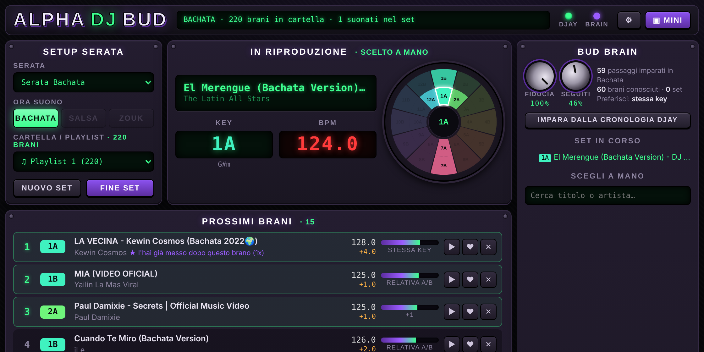
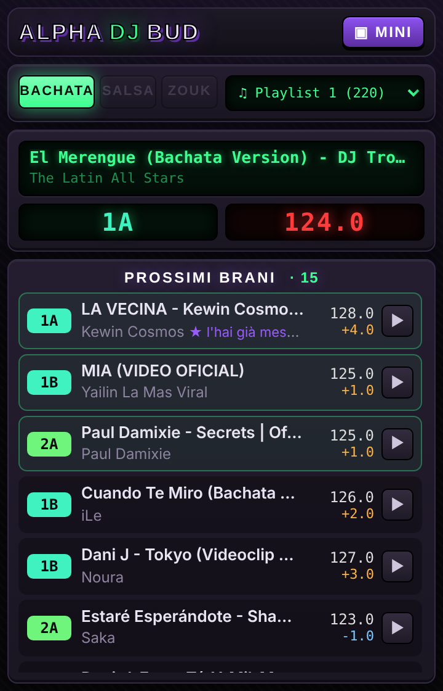

# Alpha DJ Bud

Assistente per DJ che suona con **djay Pro su Mac** e consiglia in tempo reale i prossimi brani per serate di **Bachata, Salsa e Zouk**.



## Cosa fa

1. **Si collega a djay Pro da solo.** Legge (solo in lettura, senza modificare nulla) la libreria di djay: `~/Music/djay/djay Media Library.djayMediaLibrary/MediaLibrary.db`. Quando fai partire un brano, djay lo scrive nella cronologia e Bud se ne accorge in circa 1–2 secondi.
2. **Si imposta prima della serata:**
   - **Serata**: Bachata, Salsa, Zouk oppure mista.
   - **Ora suono**: il genere che stai suonando in quel momento.
   - **Cartella/Playlist**: una cartella o playlist di djay per ogni genere (le cartelle includono tutte le playlist che contengono). Bud ricorda la scelta per ogni genere.
3. **Consiglia i prossimi brani** della cartella scelta, con queste regole:
   - **Key (Camelot Wheel)**. Esempio con 3A in riproduzione: **3A, 3B, 2A, 4A** e **9A, 9B** (salto di 6). Vale allo stesso modo per le key B.
   - **BPM**: lo stesso BPM oppure al massimo **±4** (il valore si può cambiare).
   - **Mai lo stesso artista di seguito.** Riconosce anche featuring e collaborazioni ("Romeo Santos & Drake", "feat. Romeo Santos"...). Puoi estendere la regola agli ultimi N brani.
   - Esclude i brani già suonati nel set.
4. **Impara i tuoi gusti** (sul tuo Mac, offline, separatamente per ogni genere). Registra:
   - i passaggi che fai davvero, seguendo i consigli o no;
   - i brani che suoni più spesso;
   - le relazioni di key che preferisci e se tendi ad alzare o abbassare i BPM;
   - i consigli che ignori sempre;
   - i ♥ e le ✕ che dai.

   Più set suoni, più conta questa parte (indicatore **FIDUCIA**). Con **"Impara dalla cronologia djay"** Bud impara anche dai set che hai già suonato in passato.
5. **Finestra MINI**: con il pulsante **▣ MINI** l'app diventa una finestrella di 360×560 **sempre in primo piano** sopra djay. Mostra solo il genere, il brano in riproduzione e la lista dei consigli.



## Installazione (Mac)

1. Scarica il repository (pulsante verde **Code → Download ZIP**) e scompattalo, per esempio in `Applicazioni` o in `Documenti`.
2. Fai **doppio clic** su `Avvia Alpha DJ Bud.command`.
   - La prima volta macOS può bloccarlo. In quel caso: tasto destro → **Apri** → **Apri**.
   - Al primo avvio installa `pywebview` (serve internet una sola volta), che dà la finestra nativa e la modalità sempre in primo piano.
   - Se Python 3 manca, apri il Terminale e lancia `xcode-select --install`.
3. Apri djay Pro, scegli il genere e la cartella in Alpha DJ Bud e inizia a suonare.

Senza `pywebview` l'app si apre in Chrome/Edge/Brave in modalità app oppure nel browser predefinito (in questi casi la finestra non resta sopra djay).

Da Terminale:

```bash
python3 -m alpha_dj_bud.app            # finestra nativa
python3 -m alpha_dj_bud.app --browser  # nel browser
python3 -m alpha_dj_bud.app --db "/percorso/MediaLibrary.db"
```

## Uso durante la serata

| Azione | Come |
|---|---|
| Brano in riproduzione | Automatico da djay (deck mostrato), oppure **▶** su un consiglio o ricerca in "Scegli a mano" |
| Mi piace / non proporre | **♥** / **✕** sulla riga del consiglio |
| Fine serata | **FINE SET**: salva ciò che Bud ha imparato |
| Nuovo set | **NUOVO SET**: azzera brani suonati ed esclusi |
| Impostazioni ⚙ | Tolleranza BPM, finestra artista, salto di 6, tempo doppio/metà, key dai commenti Mixed In Key, cambio genere automatico, percorso libreria |

Nella **serata mista**, se metti un brano che sta nella cartella di un altro genere, Bud cambia genere da solo.

**Key e BPM** sono quelli analizzati da djay. Se un brano non è ancora analizzato, Bud prova a leggere il BPM dal titolo (es. "… 94 Bpm"). I brani senza key o senza BPM vengono contati tra gli esclusi in fondo alla lista. Se usi Mixed In Key, puoi attivare la lettura della key Camelot scritta nei commenti.

## Dati

- Impostazioni e memoria di Bud: `~/Library/Application Support/Alpha DJ Bud/` (`settings.json`, `brain.json`). Per ripartire da zero basta cancellare `brain.json`.
- La libreria di djay non viene mai modificata.

## Struttura del codice

```
alpha_dj_bud/
  tsaf.py          decoder del formato binario TSAF di djay
  djay_library.py  cartelle, playlist, brani, key/BPM, cronologia (now playing)
  camelot.py       regole Camelot e mappatura key djay → Camelot
  artists.py       riconoscimento artisti / featuring
  recommender.py   filtri e punteggio dei consigli
  learning.py      apprendimento locale per genere
  server.py        server locale + monitor di djay
  app.py           avvio e finestra (pywebview / browser)
  web/             interfaccia (HTML/CSS/JS)
tests/             test con una libreria djay finta
```

Test: `python3 -m unittest discover -s tests -t .`

## Limiti noti

- Solo **djay Pro per macOS** (su Windows djay non espone i dati allo stesso modo).
- Il formato del database di djay non è documentato. Un aggiornamento di djay potrebbe cambiarlo; in quel caso la spia **DJAY** diventa rossa.
- Il brano in riproduzione arriva dalla cronologia di djay, quindi compare quando djay lo registra come suonato.
